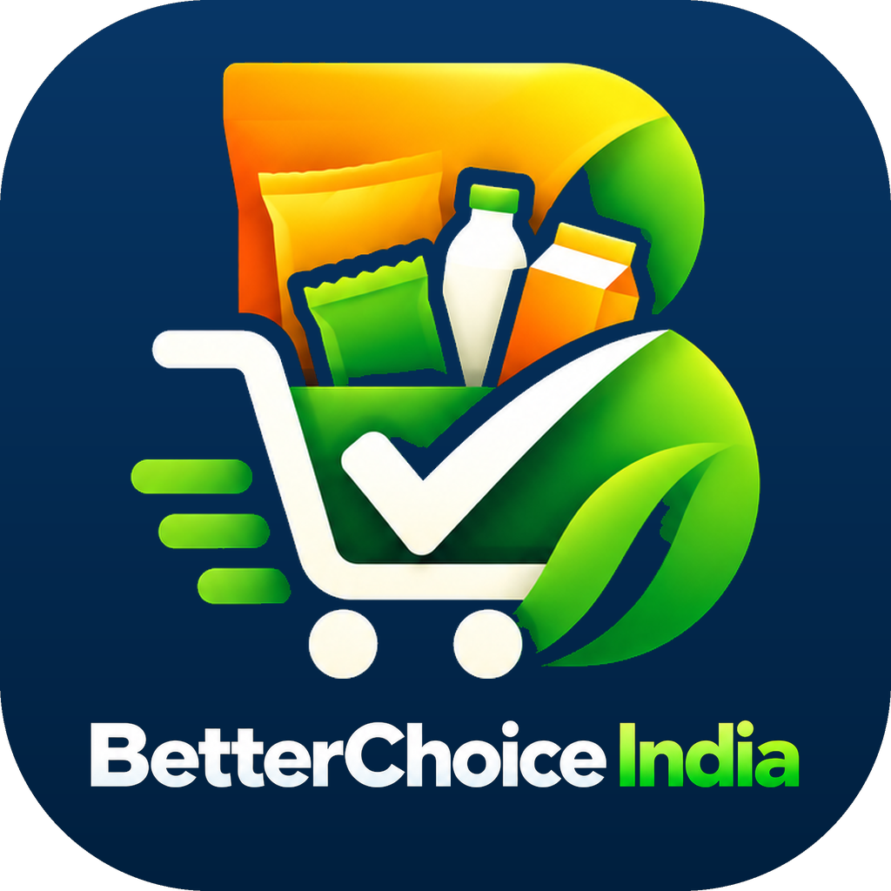
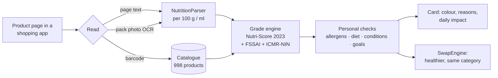

<div align="center">



# BetterChoice India

**Smarter choices · Healthier India**

An Android shopping companion that reads the nutrition label of the product you are looking at on India's
quick-commerce apps, rates it in one colour, and suggests a healthier product **from the same category**,
matched to your own goals, diet and health needs.

[](#quick-start)
[](#build-from-source)
[](CHANGELOG.md)
[](docs/nutrition-engine-reference.md)
[](#the-catalogue)
[](LICENSE)

[Quick start](#quick-start) · [How it works](#how-it-works) · [The thesis](THESIS.md) · [Build](#build-from-source) ·
[Privacy](#privacy-and-security) · [Roadmap](#roadmap)

</div>

---

## Why

Packaged food in India is increasingly bought on 10-minute delivery apps. The nutrition panel sits on a
back-of-pack photo, if it is shown at all, and the decision is made in seconds. Meanwhile diet-related disease
is rising: about one Indian adult in nine has diabetes, and more than one in three has hypertension (ICMR-INDIAB, 2023).

BetterChoice India puts the label back into the decision, at the moment of choice:

- **One colour, not a table.** 🟢 green, 🟡 yellow or 🔴 red, from the nutrients printed on the pack.
- **A better option, not a lecture.** Up to three healthier products from the *same category*, so a chips buyer is
  shown better chips, not a salad.
- **Personal where it matters.** Allergens, diet (vegetarian, eggetarian, Jain, halal, vegan), conditions
  (diabetes, blood pressure, kidney, pregnancy) and goals change which swaps are safe and how they are ranked, but
  never the colour itself.

> The full argument, design principles, evidence and open questions are in **[THESIS.md](THESIS.md)**.

## Features

| | |
|---|---|
| 🫧 **Shopping bubble** | A small bubble appears only inside supported shopping apps and turns green, yellow or red as you browse. |
| 🔎 **Reads what you see** | Product text on the page, the pack photos (on-device OCR) and the barcode. Nothing is uploaded. |
| 🧮 **Calculator-first** | Every threshold and number traces to a regulation or guideline on file ([`security/evidence`](android/security/evidence)), verified by tests. |
| 🎯 **Personal card** | Daily-impact figures and "for you" notes from a short private profile: age, sex, height, weight, activity, goals, conditions, diet and allergens. |
| 🔁 **Healthier swaps** | Same-category alternatives that pass your allergen and diet checks, ranked by your goal (weight, muscle, sugar control). |
| ⚖️ **Honest about gaps** | An unknown value is never treated as zero. If a figure that could change the colour is missing, the card says so instead of guessing. |
| 🔐 **Private by design** | Health answers stay on the phone. No screenshots are stored. Reading is limited to an allow-list of shopping apps. |

## How it works



**Colour bands.** The engine computes the Nutri-Score 2023 letter (separate algorithms for foods, fats/oils/nuts,
cheese and beverages) and shows three bands:

| Nutri-Score letter | Colour | Meaning |
|---|---|---|
| A, B | 🟢 Green | A good everyday choice in its category |
| C | 🟡 Yellow | Fine in moderation |
| D, E | 🔴 Red | A healthier option usually exists, and the card shows it |

FSSAI labelling rules and the ICMR-NIN 2024 HFSS thresholds add the reasons on the card (high sugar, high
sodium, sweeteners, additives) and the safety vetoes. Details: [nutrition engine reference](docs/nutrition-engine-reference.md).

### Supported shopping apps

| App | Package |
|---|---|
| Blinkit | `com.grofers.customerapp` |
| Zepto | `com.zeptoconsumerapp` |
| Swiggy Instamart | `in.swiggy.android`, `in.swiggy.android.instamart` |
| Zomato | `com.application.zomato` |
| Flipkart (incl. Minutes) | `com.flipkart.android` |

## Quick start

1. Download the APK from the **[latest release](../../releases/latest)** and check its SHA-256 against `SHA256SUMS.txt`.
2. Install it (allow installs from your browser or file manager when Android asks).
3. Open **BetterChoice India**, complete the short private profile, then tap **Set up the bubble** and enable the
   *BetterChoice India bubble* accessibility service after reading the disclosure.
4. Open Blinkit, Zepto, Instamart, Zomato or Flipkart and browse a packaged-food product.

> [!NOTE]
> The release APK is the **on-device edition**. Ratings, swaps and your profile work entirely on the phone, and
> account sign-in is switched off in this build. It is a debug-signed test build intended for evaluation, not a
> Play Store release.

## The catalogue

Healthier swaps come from a curated catalogue of **998 packaged products in 31 categories**, built from
[Open Food Facts](https://world.openfoodfacts.org) records with a 2025-or-later label photo. A small number of
label drafts were read from pack photos and cross-checked. Every product is graded by the same engine the app
uses, so a swap is shown only when it is healthier by the app's own rules. All records stay marked as drafts
until a nutritionist has checked them ([review guide](docs/nutritionist/NUTRITIONIST_REVIEW_GUIDE.md)).

| By the app's engine | Products |
|---|---|
| 🟢 Green | 230 |
| 🟡 Yellow | 177 |
| 🔴 Red | 583 |
| Not rated (missing figures) | 8 |

Some categories (biscuits, jams, Indian sweets, instant soups, mayonnaise) have no green or yellow product at all
under Nutri-Score 2023. There the card offers a better red one ("step within red") and says so. See
[THESIS.md § Findings](THESIS.md#5-what-the-evidence-so-far-shows).

## Editions

| | [`android/`](android) **On-device (v3.9.0)** | [`android-db/`](android-db) **Database (v4.0.0)** |
|---|---|---|
| Rating | On the phone | On the phone |
| Catalogue | Bundled in the app | Supabase Postgres: exact name → alias → trigram + `pgvector` hybrid lookup, with a phone cache |
| Network | Optional (sign-in) | Required for lookups |
| Tests | 429 unit tests, passing | 450 unit tests, passing |
| Status | Installed and field-tested | Built and tested; database seed not yet loaded |

## Build from source

Requirements: **JDK 17**, **Android SDK 37** (build tools 36.0.0), Gradle wrapper included (AGP 9.3.2 / Gradle 9.5.0).

```bash
git clone https://github.com/AdityaAero/betterchoice-india.git
cd betterchoice-india/android
./gradlew testDebugUnitTest assembleDebug
adb install -r app/build/outputs/apk/debug/app-debug.apk
```

Optional sign-in needs **public** client settings at build time. Never use server secrets:

```bash
export BC_SUPABASE_URL="https://<your-project-ref>.supabase.co"
export BC_SUPABASE_PUBLISHABLE_KEY="sb_publishable_<your-publishable-key>"
```

Without them the app runs fully on-device. Database setup: [`docs/supabase-setup.md`](docs/supabase-setup.md) and
[`android-db/DATABASE_EDITION.md`](android-db/DATABASE_EDITION.md).

## Repository layout

```
betterchoice-india/
├── android/                 # v3.9.0 on-device app (Java, Android 12+)
│   ├── app/src/main/java/   #   reading, parsing, grading, personalisation, swaps
│   ├── app/src/test/java/   #   unit and evidence tests
│   ├── security/evidence/   #   regulations and guidelines every number cites
│   ├── supabase/            #   optional sign-in backend (migrations, edge function)
│   └── tools/               #   catalogue builder, calculator cross-check, release checks
├── android-db/              # v4.0.0 database edition (Supabase + pgvector)
├── docs/                    # engine reference, security layers, Supabase setup, nutritionist guides
├── THESIS.md                # the idea, evidence and open questions
├── CHANGELOG.md
├── SECURITY.md
├── NOTICE.md                # third-party data and documents
└── LICENSE                  # all rights reserved
```

## Privacy and security

- **On the phone:** health and profile answers. **Never stored:** screenshots.
- **Scope:** the accessibility service reacts only to the allow-listed shopping apps.
- **Secrets:** none in this repository. Public client keys are injected at build time; server keys exist only inside the backend.
- **Backend (optional):** Supabase with row-level security; account deletion is an authenticated edge function.

More: [SECURITY.md](SECURITY.md) · [security layers](docs/security-layers.md) · [privacy policy](android/security/PRIVACY_POLICY.md).

## Roadmap

- [ ] 🎙️ **Voice assistant**: ask aloud ("Is this good for my sugar?") and hear the answer, in English and Hindi first
- [ ] Nutritionist sign-off of the catalogue (drafts → verified)
- [ ] More green and yellow swaps in thin categories (target: 15 green + 10 yellow per category)
- [ ] Screen capture (MediaProjection) path for Android versions that restrict accessibility
- [ ] Indian Nutrition Rating alongside the colour, once FSSAI finalises it
- [ ] Field study: does a same-category swap change what people buy?

## Disclaimer

BetterChoice India gives general nutrition information from product labels. It is **not medical advice** and does
not diagnose, treat or prescribe. People with a medical condition, pregnancy or a severe allergy should follow
their doctor's or dietitian's advice and always read the physical pack.

## License

Copyright © 2026 Aditya ([@AdityaAero](https://github.com/AdityaAero)). **All rights reserved.** The source is
published for viewing and evaluation only; see [LICENSE](LICENSE). Catalogue data derived from Open Food Facts
is available under the [Open Database License](https://opendatacommons.org/licenses/odbl/1-0/); see
[NOTICE.md](NOTICE.md).

## Acknowledgements

[Open Food Facts](https://world.openfoodfacts.org) · Nutri-Score Scientific Committee · ICMR–National Institute
of Nutrition · FSSAI · Google ML Kit
